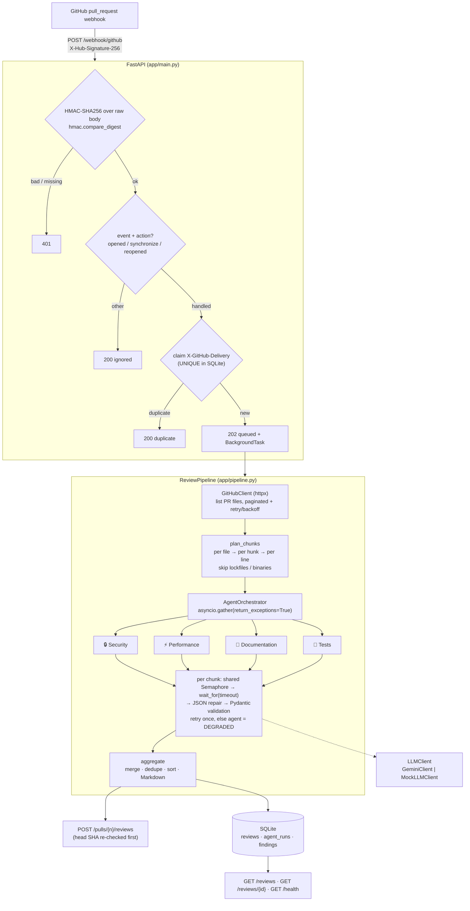

# ReviewMind

[](https://github.com/jsankalp715/reviewmind/actions/workflows/ci.yml)


ReviewMind is a multi-agent code reviewer for GitHub pull requests. A signed `pull_request` webhook
starts a background pipeline:

1. Fetch the PR's changed files.
2. Chunk the diff per file.
3. Run **four specialist LLM agents in parallel**: security, performance, documentation, tests.
4. Merge, dedupe and rank the findings.
5. Post one Markdown review back to the PR.

If an agent fails, times out or returns broken JSON, the review is still posted and says which
agent degraded.

---

## Architecture



| Layer | Module | Responsibility |
|---|---|---|
| HTTP | `app/main.py` | Webhook receiver, read API, dependency wiring (`create_app`, `build_state`) |
| Security | `app/github/webhook.py` | `verify_signature`, `parse_pull_request_event` |
| GitHub | `app/github/client.py` | `GitHubClient`: pagination, retry/backoff, `post_review` |
| Chunking | `app/chunking.py` | `plan_chunks`, `chunk_file`, `skip_reason`, `parse_unified_diff` |
| Agents | `app/agents/` | `ReviewAgent` base (retry/timeout/degrade) and four subclasses with their own prompts in `app/agents/prompts/` |
| Concurrency | `app/orchestrator.py` | `AgentOrchestrator.run` with `asyncio.gather(..., return_exceptions=True)` |
| LLM | `app/llm/` | `LLMClient` ABC, `GeminiClient` (REST over httpx), `MockLLMClient`, `json_repair` |
| Output | `app/aggregator.py` | `merge_findings`, `render_markdown`, `aggregate` |
| Storage | `app/db.py` | `ReviewRepository`: idempotent `claim_delivery`, results, reads |
| Pipeline | `app/pipeline.py` | `ReviewPipeline.run`: fetch → review → post → persist |

---

## Quick start (offline, no API keys)

```bash
python -m venv .venv && source .venv/bin/activate
pip install -r requirements-dev.txt

pytest                         # 231 tests, no network access needed
python scripts/demo.py         # replay a signed webhook end to end with the mock LLM
python scripts/demo.py --fault performance:timeout --fault documentation:garbage
```

### Demo output (actual run of `python scripts/demo.py`)

The demo runs the **real** app (FastAPI, HMAC check, idempotency, SQLite, chunker, agents,
orchestrator, aggregator) against a mocked GitHub and `MockLLMClient`. The mock is a
deterministic, regex-based reviewer, **not** an LLM. It exists so the whole pipeline can be shown
and tested offline. The input is `tests/fixtures/sample_pr.diff`: three Python files with
deliberately planted bugs, plus a lockfile and a PNG.

```text
[1] Webhook with a forged signature  -> HTTP 401 {'detail': 'invalid or missing signature'}
[2] Signed pull_request webhook      -> HTTP 202 {'status': 'queued', 'review_id': 1}
    (202 sent first; TestClient also waits for the review: 0.18s)
[3] Same X-GitHub-Delivery again     -> HTTP 200 {'status': 'duplicate', 'review_id': 1, 'review_status': 'completed'}
[4] GET /reviews/1: status=completed, findings=41, degraded=[]
    agent_runs:
      - security      ok           54 ms  attempts=3  tokens~3446
      - performance   ok          106 ms  attempts=3  tokens~3269
      - documentation ok          158 ms  attempts=3  tokens~3696
      - tests         ok          158 ms  attempts=3  tokens~3489
    LLM calls: 12, peak concurrent calls: 4
[5] Reviews posted to GitHub: 1
```

<details>
<summary>Full review posted to the PR (raw Markdown)</summary>

````markdown
## 🤖 ReviewMind review

**41 finding(s)** across **3** reviewed file(s) — 🔴 4 critical · 🟠 11 high · 🟡 12 medium · 🔵 14 low

| Agent | Status | Findings | 🔴 Critical | 🟠 High | 🟡 Medium | 🔵 Low | Latency |
|---|---|---:|---:|---:|---:|---:|---:|
| 🔒 Security | ✅ ok | 8 | 4 | 2 | 2 | 0 | 0.1s |
| ⚡ Performance | ✅ ok | 8 | 0 | 5 | 3 | 0 | 0.1s |
| 📝 Documentation | ✅ ok | 14 | 0 | 0 | 0 | 14 | 0.2s |
| 🧪 Tests | ✅ ok | 11 | 0 | 4 | 7 | 0 | 0.2s |

### 🔒 Security (8)
- 🔴 **CRITICAL** `app/auth.py:6` — **Hardcoded secret in `DB_PASSWORD`**
  A credential is committed to source control. Anyone with read access to the repository (or its history) can use it.
  > 💡 Load `DB_PASSWORD` from an environment variable or a secrets manager, and rotate the exposed value.
- 🔴 **CRITICAL** `app/auth.py:7` — **Hardcoded secret in `API_KEY`**
  A credential is committed to source control. Anyone with read access to the repository (or its history) can use it.
  > 💡 Load `API_KEY` from an environment variable or a secrets manager, and rotate the exposed value.
- 🔴 **CRITICAL** `app/auth.py:12` — **SQL injection via string-built query**
  User-controlled values are concatenated into SQL, so input such as `' OR '1'='1` changes the query's meaning.
  > 💡 Use parameterised queries, e.g. `conn.execute("... WHERE username = ?", (username,))`.
- 🔴 **CRITICAL** `app/utils.py:18` — **Arbitrary code execution via `eval`/`exec`**
  Evaluating file or request content executes arbitrary Python.
  > 💡 Parse data with a safe loader such as `json.loads` or `ast.literal_eval`.
- 🟠 **HIGH** `app/auth.py:20` — **Predictable token from the `random` module**
  `random` is not cryptographically secure, and a 6-digit space is brute-forceable.
  > 💡 Use `secrets.token_urlsafe(32)`.
- 🟠 **HIGH** `app/utils.py:17` — **Path traversal in file open**
  A caller-supplied path joined onto a base directory can escape it via `../`.
  > 💡 Resolve the path and check that it stays under the base directory before opening it.
- 🟡 **MEDIUM** `app/auth.py:24` — **Outbound request built from caller input (SSRF risk)**
  The request URL is derived from a parameter with no allow-list, so a caller can make the server reach internal hosts.
  > 💡 Validate the host against an allow-list and URL-encode path parameters.
- 🟡 **MEDIUM** `app/utils.py:11` — **Outbound request built from caller input (SSRF risk)**
  The request URL is derived from a parameter with no allow-list, so a caller can make the server reach internal hosts.
  > 💡 Validate the host against an allow-list and URL-encode path parameters.

### ⚡ Performance (8)
- 🟠 **HIGH** `app/reports.py:7` — **N+1 query pattern: data access inside a loop**
  A database/API call runs once per loop iteration, so latency grows with the input size.
  > 💡 Batch the lookup (e.g. `WHERE id IN (...)`) before the loop, then join in memory.
- 🟠 **HIGH** `app/reports.py:8` — **N+1 query pattern: data access inside a loop**
  A database/API call runs once per loop iteration, so latency grows with the input size.
  > 💡 Batch the lookup (e.g. `WHERE id IN (...)`) before the loop, then join in memory.
- 🟠 **HIGH** `app/reports.py:10` — **N+1 query pattern: data access inside a loop**
  A database/API call runs once per loop iteration, so latency grows with the input size.
  > 💡 Batch the lookup (e.g. `WHERE id IN (...)`) before the loop, then join in memory.
- 🟠 **HIGH** `app/reports.py:19` — **Quadratic nested loop over the same collection**
  Two nested loops over `len(data)` make this O(n²); it slows down sharply on large inputs.
  > 💡 Sort once, or use a set/dict lookup to make it O(n log n) or O(n).
- 🟠 **HIGH** `app/utils.py:11` — **Blocking call inside `async def`**
  A synchronous HTTP call or sleep blocks the event loop, stalling every other coroutine.
  > 💡 Use `httpx.AsyncClient` / `asyncio.sleep`, or move the call to `asyncio.to_thread`.
- 🟡 **MEDIUM** `app/auth.py:24` — **HTTP call without a timeout**
  `requests` waits forever by default, so one slow upstream can exhaust workers.
  > 💡 Pass an explicit `timeout=(3, 10)`.
- 🟡 **MEDIUM** `app/reports.py:27` — **Unbounded `SELECT *` loaded into memory**
  `fetchall()` on an unfiltered table loads every row and column at once.
  > 💡 Select only the columns you need, and paginate or stream with `LIMIT`/`OFFSET`.
- 🟡 **MEDIUM** `app/utils.py:11` — **HTTP call without a timeout**
  `requests` waits forever by default, so one slow upstream can exhaust workers.
  > 💡 Pass an explicit `timeout=(3, 10)`.

### 📝 Documentation (14)

<details><summary>14 low-severity finding(s)</summary>

- 🔵 **LOW** `app/auth.py:19` — **Missing docstring on public function `generate_session_token`**
  Readers have to infer the contract (inputs, return value, errors) from the body.
  > 💡 Add a docstring describing what `generate_session_token` does and returns.
- 🔵 **LOW** `app/auth.py:23` — **Missing docstring on public function `get_user_profile`**
  Readers have to infer the contract (inputs, return value, errors) from the body.
  > 💡 Add a docstring describing what `get_user_profile` does and returns.
- 🔵 **LOW** `app/reports.py:4` — **Missing docstring on public function `generate_report`**
  Readers have to infer the contract (inputs, return value, errors) from the body.
  > 💡 Add a docstring describing what `generate_report` does and returns.
- 🔵 **LOW** `app/reports.py:16` — **Missing docstring on public function `process_data`**
  Readers have to infer the contract (inputs, return value, errors) from the body.
  > 💡 Add a docstring describing what `process_data` does and returns.
- 🔵 **LOW** `app/reports.py:25` — **Missing docstring on public function `get_all_records`**
  Readers have to infer the contract (inputs, return value, errors) from the body.
  > 💡 Add a docstring describing what `get_all_records` does and returns.
- 🔵 **LOW** `app/reports.py:30` — **Missing docstring on public function `calculate_score`**
  Readers have to infer the contract (inputs, return value, errors) from the body.
  > 💡 Add a docstring describing what `calculate_score` does and returns.
- 🔵 **LOW** `app/reports.py:30` — **Single-letter names in `calculate_score`**
  `x`, `y`, `z`, `t`, `n`, `v` do not convey what they hold.
  > 💡 Rename them to describe their meaning (e.g. `weight`, `offset`, `items`).
- 🔵 **LOW** `app/reports.py:31` — **Magic numbers in `calculate_score`: `1.337`, `42`**
  Unexplained numeric literals hide intent and are easy to change inconsistently.
  > 💡 Extract them into named module-level constants with a short comment.
- 🔵 **LOW** `app/utils.py:1` — **Missing docstring on public function `process_items`**
  Readers have to infer the contract (inputs, return value, errors) from the body.
  > 💡 Add a docstring describing what `process_items` does and returns.
- 🔵 **LOW** `app/utils.py:9` — **Missing docstring on public function `fetch_external_data`**
  Readers have to infer the contract (inputs, return value, errors) from the body.
  > 💡 Add a docstring describing what `fetch_external_data` does and returns.
- 🔵 **LOW** `app/utils.py:15` — **Missing docstring on public function `load_config`**
  Readers have to infer the contract (inputs, return value, errors) from the body.
  > 💡 Add a docstring describing what `load_config` does and returns.
- 🔵 **LOW** `app/utils.py:21` — **Missing docstring on public class `DataProcessor`**
  Readers have to infer the contract (inputs, return value, errors) from the body.
  > 💡 Add a docstring describing what `DataProcessor` does and returns.
- 🔵 **LOW** `app/utils.py:22` — **Missing docstring on public function `process`**
  Readers have to infer the contract (inputs, return value, errors) from the body.
  > 💡 Add a docstring describing what `process` does and returns.
- 🔵 **LOW** `app/utils.py:22` — **Single-letter names in `process`**
  `d`, `r`, `t` do not convey what they hold.
  > 💡 Rename them to describe their meaning (e.g. `weight`, `offset`, `items`).

</details>

### 🧪 Tests (11)
- 🟠 **HIGH** `app/auth.py:10` — **No tests for `authenticate_user`**
  `authenticate_user` is new or changed, and this PR contains no test changes covering it.
  > 💡 Add `test_authenticate_user` covering the happy path, empty/None input, and the error path.
- 🟠 **HIGH** `app/auth.py:19` — **No tests for `generate_session_token`**
  `generate_session_token` is new or changed, and this PR contains no test changes covering it.
  > 💡 Add `test_generate_session_token` covering the happy path, empty/None input, and the error path.
- 🟠 **HIGH** `app/reports.py:30` — **No tests for `calculate_score`**
  `calculate_score` is new or changed, and this PR contains no test changes covering it.
  > 💡 Add `test_calculate_score` covering the happy path, empty/None input, and the error path.
- 🟠 **HIGH** `app/utils.py:15` — **No tests for `load_config`**
  `load_config` is new or changed, and this PR contains no test changes covering it.
  > 💡 Add `test_load_config` covering the happy path, empty/None input, and the error path.
- 🟡 **MEDIUM** `app/auth.py:23` — **No tests for `get_user_profile`**
  `get_user_profile` is new or changed, and this PR contains no test changes covering it.
  > 💡 Add `test_get_user_profile` covering the happy path, empty/None input, and the error path.
- 🟡 **MEDIUM** `app/reports.py:4` — **No tests for `generate_report`**
  `generate_report` is new or changed, and this PR contains no test changes covering it.
  > 💡 Add `test_generate_report` covering the happy path, empty/None input, and the error path.
- 🟡 **MEDIUM** `app/reports.py:16` — **No tests for `process_data`**
  `process_data` is new or changed, and this PR contains no test changes covering it.
  > 💡 Add `test_process_data` covering the happy path, empty/None input, and the error path.
- 🟡 **MEDIUM** `app/reports.py:25` — **No tests for `get_all_records`**
  `get_all_records` is new or changed, and this PR contains no test changes covering it.
  > 💡 Add `test_get_all_records` covering the happy path, empty/None input, and the error path.
- 🟡 **MEDIUM** `app/utils.py:1` — **No tests for `process_items`**
  `process_items` is new or changed, and this PR contains no test changes covering it.
  > 💡 Add `test_process_items` covering the happy path, empty/None input, and the error path.
- 🟡 **MEDIUM** `app/utils.py:9` — **No tests for `fetch_external_data`**
  `fetch_external_data` is new or changed, and this PR contains no test changes covering it.
  > 💡 Add `test_fetch_external_data` covering the happy path, empty/None input, and the error path.
- 🟡 **MEDIUM** `app/utils.py:22` — **No tests for `process`**
  `process` is new or changed, and this PR contains no test changes covering it.
  > 💡 Add `test_process` covering the happy path, empty/None input, and the error path.

<details><summary>Skipped files (2)</summary>

- `assets/logo.png` — binary file
- `poetry.lock` — lockfile

</details>

---
<sub>ReviewMind 2.0.0 · head `3f2c1a9` · 2026-10-14 23:49 UTC</sub>
````

</details>

With two agents sabotaged (`--fault performance:timeout --fault documentation:garbage --timeout 0.5`),
the other two agents still finish and the review is still posted:

```text
[1] Webhook with a forged signature  -> HTTP 401 {'detail': 'invalid or missing signature'}
[2] Signed pull_request webhook      -> HTTP 202 {'status': 'queued', 'review_id': 1}
    (202 sent first; TestClient also waits for the review: 1.17s)
[3] Same X-GitHub-Delivery again     -> HTTP 200 {'status': 'duplicate', 'review_id': 1, 'review_status': 'completed'}
[4] GET /reviews/1: status=completed, findings=19, degraded=['performance', 'documentation']
    agent_runs:
      - security      ok           54 ms  attempts=3  tokens~3446
      - performance   degraded   1158 ms  attempts=6  tokens~5234  error='3/3 chunk(s) failed after retry: timed out after 0.5s (app/auth.py, ap'
      - documentation degraded    511 ms  attempts=6  tokens~5340  error='3/3 chunk(s) failed after retry: invalid JSON from model: no valid JSO'
      - tests         ok          359 ms  attempts=3  tokens~3489
    LLM calls: 18, peak concurrent calls: 4
[5] Reviews posted to GitHub: 1
```

```markdown
## 🤖 ReviewMind review

**19 finding(s)** across **3** reviewed file(s) — 🔴 4 critical · 🟠 6 high · 🟡 9 medium

> ⚠️ **Partial review:** **performance**, **documentation** degraded. Their findings may be incomplete; see *Degraded agents* below.

| Agent | Status | Findings | 🔴 Critical | 🟠 High | 🟡 Medium | 🔵 Low | Latency |
|---|---|---:|---:|---:|---:|---:|---:|
| 🔒 Security | ✅ ok | 8 | 4 | 2 | 2 | 0 | 0.1s |
| ⚡ Performance | ⚠️ degraded | 0 | 0 | 0 | 0 | 0 | 1.2s |
| 📝 Documentation | ⚠️ degraded | 0 | 0 | 0 | 0 | 0 | 0.5s |
| 🧪 Tests | ✅ ok | 11 | 0 | 4 | 7 | 0 | 0.4s |

...

### ⚠️ Degraded agents

| Agent | Reason |
|---|---|
| ⚡ Performance | 3/3 chunk(s) failed after retry: timed out after 0.5s (app/auth.py, app/reports.py, app/utils.py) |
| 📝 Documentation | 3/3 chunk(s) failed after retry: invalid JSON from model: no valid JSON found in response (app/auth.py, app/reports.py, app/utils.py) |
```

---

## Running for real

### 1. Configure

```bash
cp .env.example .env
```

| Variable | Default | Purpose |
|---|---|---|
| `LLM_PROVIDER` | `gemini` | `gemini` or `mock`. Startup fails if `gemini` has no key. |
| `GEMINI_API_KEY` | – | Google AI Studio key (sent as the `x-goog-api-key` header, never in the URL) |
| `GEMINI_MODEL` | `gemini-2.0-flash` | Any `generateContent` model, e.g. `gemini-2.5-flash` |
| `GITHUB_TOKEN` | – | Fine-grained PAT: *Pull requests: read & write*, *Contents: read* |
| `GITHUB_WEBHOOK_SECRET` | – | **Required.** Without it every webhook is rejected (503). |
| `API_TOKEN` | – | Bearer token for `GET /reviews*` (recommended in any shared deployment) |
| `POST_REVIEWS` | `true` | `false` = review and store, but don't post to GitHub |
| `AGENT_TIMEOUT_SECONDS` | `60` | Timeout per LLM attempt per chunk |
| `AGENT_MAX_RETRIES` | `1` | Retries before an agent is marked degraded |
| `LLM_MAX_CONCURRENCY` | `4` | Max in-flight LLM calls across **all** agents and reviews |
| `ENABLED_AGENTS` | all four | e.g. `security,tests` |
| `CHUNK_MAX_TOKENS` / `CHARS_PER_TOKEN` | `6000` / `4` | Per-chunk budget (estimated as characters ÷ 4) |
| `MAX_CHUNKS_PER_REVIEW` | `40` | Cost cap. Extra files are listed as skipped. |
| `GITHUB_MAX_RETRIES` / `GITHUB_BACKOFF_MAX_SECONDS` | `4` / `60` | GitHub retry policy |
| `DATABASE_PATH` | `reviewmind.db` | SQLite file |
| `LOG_LEVEL` / `LOG_FORMAT` | `INFO` / `json` | `LOG_FORMAT=text` for local development |

`.env.example` lists every setting.

### 2. Check your Gemini key

```bash
python scripts/live_smoke.py gemini
```

### 3. Run the server

```bash
uvicorn app.main:app --port 8000          # or: docker compose up --build
curl localhost:8000/health
```

### 4. Expose it and register the webhook (local development)

GitHub has to be able to reach your machine. Pick one:

**smee.io** (free, no account):
```bash
npx smee-client --url https://smee.io/<your-channel> --target http://localhost:8000/webhook/github
```
Use `https://smee.io/<your-channel>` as the payload URL. Note that the smee client re-serialises
the JSON body. That normally gives back identical bytes, but if you get 401s through smee (for
example, PR titles with unusual characters), use ngrok, which forwards the bytes untouched.

**ngrok**:
```bash
ngrok http 8000      # payload URL: https://<id>.ngrok-free.app/webhook/github
```

Then, in **Repo → Settings → Webhooks → Add webhook**:

| Field | Value |
|---|---|
| Payload URL | the smee/ngrok URL ending in `/webhook/github` |
| Content type | `application/json` |
| Secret | the same value as `GITHUB_WEBHOOK_SECRET` (`python -c "import secrets; print(secrets.token_hex(32))"`) |
| Events | *Let me select individual events* → **Pull requests** only |

GitHub immediately sends a `ping`, which should show a green ✓ (`{"status": "pong"}`). Then open or
push to a PR.

Or with the GitHub CLI:
```bash
gh api repos/OWNER/REPO/hooks --method POST \
  -f name=web -F active=true -f 'events[]=pull_request' \
  -f config[url]=https://<public-url>/webhook/github \
  -f config[content_type]=json -f config[secret]="$GITHUB_WEBHOOK_SECRET"
```

### 5. Smoke-test against a real PR

```bash
python scripts/live_smoke.py review --repo OWNER/REPO --pr 123          # prints, posts nothing
python scripts/live_smoke.py review --repo OWNER/REPO --pr 123 --post   # also posts the review
python scripts/live_smoke.py webhook --repo OWNER/REPO --pr 123 \
    --url http://localhost:8000/webhook/github                          # signed webhook → running server
```

### API

| Method | Path | Notes |
|---|---|---|
| `POST` | `/webhook/github` | GitHub webhook (`/webhook` is kept as an alias). 202 queued · 200 ignored/duplicate/pong · 401 bad signature · 400/422 bad payload · 413 too large · 503 no secret configured |
| `GET` | `/health` | Status, version, provider, DB check (503 if the DB is unreachable) |
| `GET` | `/reviews?limit=&offset=&repo=&pr_number=` | Newest first. Bearer `API_TOKEN` if one is configured. |
| `GET` | `/reviews/{id}` | Review with its `agent_runs` (status, latency, error, token estimate) and `findings` |

Review statuses: `queued` → `running` → `completed` | `failed` | `superseded` (new commits
arrived during the review, so it was not posted).

---

## Design decisions

The full list, with reasoning, is in [DECISIONS.md](DECISIONS.md). These are the main ones.

### Concurrency

- Each agent reviews every chunk. Calls are `asyncio` coroutines on one event loop, with no threads
  for I/O: GitHub and Gemini both go through `httpx.AsyncClient`, and SQLite runs via
  `asyncio.to_thread`.
- `AgentOrchestrator.run` starts all four agents with
  `asyncio.gather(*agents, return_exceptions=True)`. Inside each agent, `ReviewAgent.run` gathers
  its chunks the same way.
- **One `asyncio.Semaphore(LLM_MAX_CONCURRENCY)`** is shared by every agent and every concurrent
  review. It caps total in-flight LLM calls (provider rate limits), not just the calls of one
  review. The per-attempt timeout is applied *inside* the semaphore, so time spent queued is
  never counted as a model timeout.
- The webhook does no slow work in the request: it verifies, claims the delivery and returns
  **202**. The review runs as a background task, well within GitHub's 10-second delivery timeout.

### Fault isolation

There are two layers. Both are tested in `tests/test_fault_isolation.py`.

1. **Inside each agent** (`ReviewAgent.review_chunk`): every chunk call is
   `wait_for(llm.complete(...), timeout)`. On a timeout, an `LLMError`, or output that
   `parse_review_response` can't repair, it retries once (with a "JSON only" hint after bad JSON).
   If the retry also fails, the chunk is marked failed. The agent never raises for these. It
   returns an `AgentRun` with `status=degraded`, the error, and any findings from its *other*
   chunks. Non-retryable provider errors (such as a bad API key) skip the pointless retry.
2. **Across agents** (`AgentOrchestrator.run`): `return_exceptions=True` means even an unexpected
   bug that escapes an agent turns into a `degraded` `AgentRun` instead of cancelling its siblings.

The aggregator then renders a **"Partial review" banner**, marks the agent ⚠️ in the summary table,
and adds a **"Degraded agents"** section with the reason. Every agent's status, latency, attempts,
error and token estimate is stored in `agent_runs`.

### HMAC security

- `verify_signature` computes `"sha256=" + HMAC_SHA256(secret, raw_body)` and compares it with
  `hmac.compare_digest` (constant time, so no timing side-channel). It hashes the **raw request
  bytes** from `await request.body()`. Re-serialising parsed JSON would change the bytes; a test
  proves the signature then fails.
- The check runs **before** anything else is parsed, including the event header. A missing,
  malformed, or wrong signature, and a tampered body, all return **401**.
- **Fails closed:** if `GITHUB_WEBHOOK_SECRET` is unset, all webhooks get **503**. The original
  code skipped verification in that case.
- **Idempotency:** `X-GitHub-Delivery` is a `UNIQUE` column. `claim_delivery` lets SQLite decide
  atomically, so concurrent duplicate deliveries produce exactly one review (tested with 8 parallel
  requests). A redelivery only re-runs a review whose earlier attempt *failed*.

### Chunking

- Reviews use GitHub's per-file patches (`/pulls/{n}/files`, paginated). For large files where the
  API omits the patch, the full `.diff` is used instead.
- `plan_chunks` skips lockfiles, binaries, minified/vendored files and deletions. Each skipped file
  is listed in the review with its reason.
- Each file is one chunk. If a file's annotated diff exceeds the budget
  (`CHUNK_MAX_TOKENS × CHARS_PER_TOKEN`, default 24,000 characters), it is split **on hunk
  boundaries** and hunks are greedily packed. A single hunk that is still too big is split **on
  line boundaries**, repeating its header.
- Every diff line carries its new-file line number, so the model can cite exact lines and the
  numbers survive any split.
- Token counts are an *estimate* (characters ÷ 4). No tokenizer is used. Actual Gemini usage
  counts are recorded when the API returns them.
- `MAX_CHUNKS_PER_REVIEW` caps cost. Files past the cap are listed as skipped, never silently
  truncated.

### Known limitations

- `MockLLMClient` is a heuristic stand-in for tests and demos, not a code reviewer.
- Small files are not batched into shared LLM calls, so a PR with 40 tiny files costs
  40 × 4 calls.
- Reviews run in the web process (FastAPI `BackgroundTasks`). There is no external queue. A crash
  mid-review leaves the row `running`; it is marked `failed` at the next startup and can be retried
  via GitHub's "Redeliver" button.
- Findings are posted as one review body, not as inline line comments.

---

## Project layout

```text
app/
  main.py            FastAPI app factory, webhook + read API
  config.py          pydantic-settings Settings
  pipeline.py        fetch → chunk → agents → aggregate → post → persist
  orchestrator.py    parallel agents with fault isolation
  chunking.py        diff parsing, skip rules, per-file/hunk/line chunking
  aggregator.py      dedupe, sort, Markdown rendering
  db.py              SQLite repository (reviews, agent_runs, findings)
  logging_config.py  JSON/text structured logging with context vars
  models.py          Pydantic models (Finding, AgentRun, ...)
  agents/            ReviewAgent base + security/performance/documentation/tests, prompts/
  llm/               LLMClient, GeminiClient, MockLLMClient, json_repair, factory
  github/            GitHubClient, webhook signature + payload parsing
scripts/demo.py      offline end-to-end demo
scripts/live_smoke.py  real Gemini / GitHub smoke tests
tests/               231 tests, 97% coverage of app/
```

Development: `ruff check . && ruff format --check . && pytest --cov=app`.
